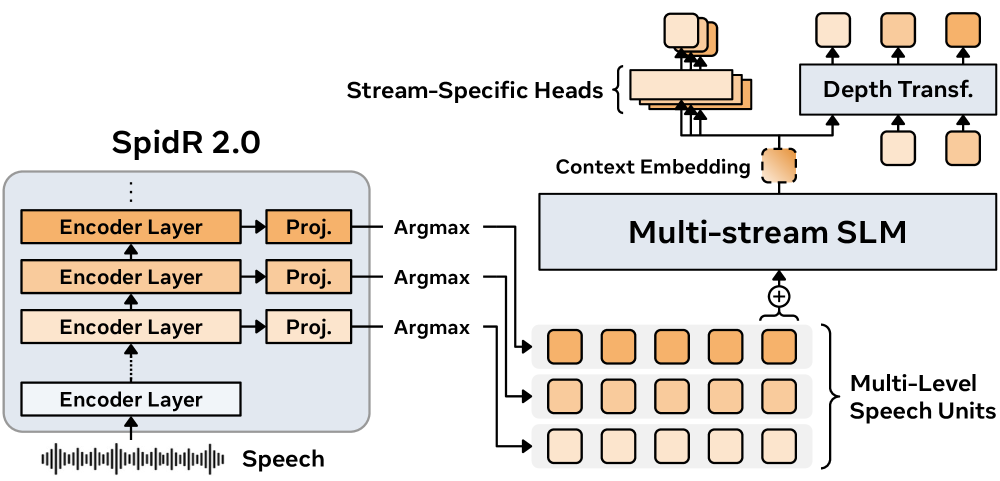

# GSLM2: Multi-Stream Speech Representation Learning and Generative Spoken Language Modeling

This repository provides research code for **GSLM2**, with training and
evaluation pipelines for:

- **Speech encoders:** SpidR 2.0, including representation evaluation and
  speech-unit extraction.
- **Language models (LMs):** single-stream spoken LMs (SLMs),
  multi-stream GSLM2, and text LMs.
- **Speech synthesis:** duration predictors and unit vocoders.

<p align="center">
  
</p>

*GSLM2 overview: SpidR 2.0 extracts multi-level speech units, which are modeled jointly by a multi-stream SLM.*

See the [model zoo](docs/model-zoo.md) for released checkpoints.

## Installation

Requires **Python 3.12+**. Use the environment for your task:

| Conda environment | Install extra | Tasks | Training stack |
|---|---|---|---|
| `gslm2` | `native` | Encoders, unit extraction, and speech synthesis | PyTorch 2.13.0 |
| `gslm2_lm` | `lm` | LM preparation, training, and evaluation | fairseq2 0.7 with PyTorch 2.9.0 |

Commands in this documentation use Bash from the repository root. Replace
`/path/to/...` with absolute local paths; YAML does not expand shell variables.

> [!NOTE]
> LM training and benchmark evaluation currently require
> [fairseq2](https://github.com/facebookresearch/fairseq2). Native PyTorch support
> is planned for a future release.

See [Environment setup](docs/environment.md) for detailed installation instructions.

## Training

Choose a [config template](configs/README.md) and set your Slurm account and QoS
in the launch commands.

### SpidR 2.0 encoder

Follow the [encoder guide](configs/encoder/README.md) to choose a LibriSpeech or
VoxPopuli config, prepare manifests, launch training, and resume a run.

### Speech and text LMs

Follow the [LM guide](configs/lm/README.md) to choose an experiment, prepare data,
train, evaluate, and resume a run.

### Duration prediction and vocoding

Follow [Speech synthesis](docs/synthesis.md) to extract full-rate units, train
duration and vocoder models in `gslm2`, and generate audio.

## Repository layout

| Path | Contents |
|---|---|
| `src/gslm2/encoder/` | SpidR 2.0 models, audio datasets, training, evaluation, and unit extraction |
| `src/gslm2/lm/` | LMs, token datasets, training recipes, preparation, and evaluation |
| `src/gslm2/eval/generative/` | ASR, conditional GenPPL, repetition, calibration, and LLM judging |
| `src/gslm2/duration/`, `src/gslm2/vocoder/` | Duration and unit HiFi-GAN training and inference |
| `src/gslm2/synthesis.py` | Duration expansion followed by unit vocoding |
| `src/gslm2/shared/` | Audio I/O, logging, distributed processing, and Slurm utilities |
| `configs/` | Encoder, LM, extraction, duration, vocoder, and generative speech evaluation templates |
| `scripts/` | Launchers, analysis, and figure scripts |
| `docs/` | Guides for data, experiments, synthesis, environments, and checkpoints |
| `environment/` | Reference Conda exports and pip package snapshots |

## Further reading

- [Data](docs/data.md) — corpora and manifest formats.
- [Reproducing experiments](docs/reproducing.md) — experiment commands and evaluation.
- [Speech synthesis](docs/synthesis.md) — duration prediction, vocoding, and audio generation.
- [Generative evaluation](docs/generative-evaluation.md) — continuation generation,
  ASR, conditional GenPPL, repetition calibration, and LLM judging.
- [Model zoo](docs/model-zoo.md) — checkpoint information.
- [Environment setup](docs/environment.md) — dependency versions,
  CUDA/FFmpeg setup, and verification.

For contributions, see the [contributing guide](.github/CONTRIBUTING.md)
and [code of conduct](.github/CODE_OF_CONDUCT.md).

<!-- ## Citation

If you use this code or the released models in your research, please cite
**GSLM2: Multi-Stream Speech Representation Learning and Generative Spoken
Language Modeling**.

```bibtex
@article{higuchi_fizycki2026gslm2,
  title={GSLM2: Multi-Stream Speech Representation Learning and Generative Spoken Language Modeling},
  author={Yosuke Higuchi and Tom Fizycki and Mahi Luthra and Charles-Éric Saint-James and Azeez Syed and Angel Villar-Corrales and Mido Assran and Nicolas Ballas and Jiayi Shen and Dongyan Lin and Phillip Rust and Surya Parimi and Vanessa Stark and Alexandre Allauzen and Balázs Kégl and Juan Pino and Emmanuel Dupoux},
  journal={arXiv preprint arXiv:XXXX.XXXXX},
  year={2026},
}
``` -->

## Acknowledgements

We thank the authors and maintainers of the following codebases:

- [torchaudio](https://github.com/pytorch/audio) — encoder components
  and speech dataset code.
- [fairseq](https://github.com/facebookresearch/fairseq) — HuBERT
  k-means training code.
- [fairseq2](https://github.com/facebookresearch/fairseq2) — language
  modeling infrastructure.
- [textlesslib](https://github.com/facebookresearch/textlesslib) —
  distributed processing utilities.
- [unit-hifigan](https://github.com/bootphon/unit-hifigan) —
  unit vocoder architectures.

## License

Source code and model checkpoints are provided under CC BY-NC 4.0.
